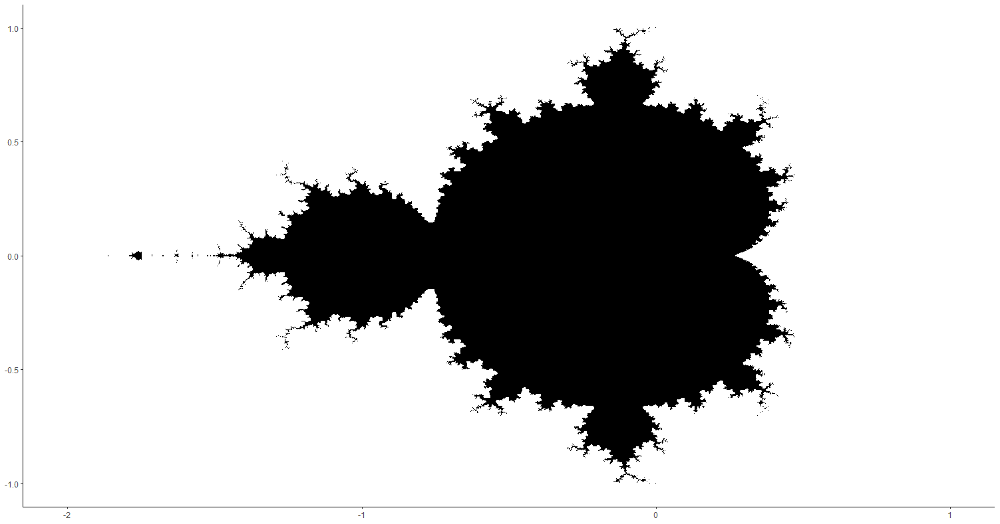

**Datas:** pasta 12/05/2023 · código 12/05/2023 (`Mandelbrot.Rmd`)

# Mandelbrot (visual)

Experimento numérico tipo **conjunto de Mandelbrot** e heatmap da iteração.

## O que o código faz

`Mandelbrot.Rmd`:

- Loop sobre grade no plano complexo, conta iterações até escape.
- `graph_mandelbrot()` com `ggplot2`.
- `Rplot.png` — figura exportada; `rmd.txt` — notas auxiliares.

## Dados

Gerados na hora (sem CSV).

## Como rodar

Knit `Mandelbrot.Rmd` (pode demorar se a grade for fina).